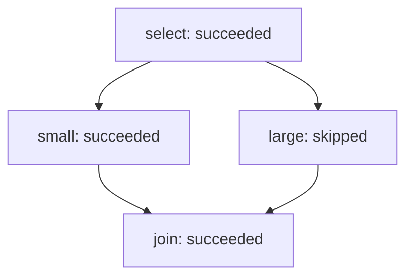

Graph `branch` · version 1 · revision 14

| Node | Owner | State | Dependencies | Evidence (kind/verdict) | Risk / next step |
|---|---|---|---|---|---|
| select | single-agent-fixture | succeeded | — | [select-check.json](select-check.json) (execution/pass, v1) | see node loop and dependency state |
| small | single-agent-fixture | succeeded | select | [small-check.json](small-check.json) (execution/pass, v1) | see node loop and dependency state |
| large | single-agent-fixture | skipped | select | none | see node loop and dependency state |
| join | single-agent-fixture | succeeded | small, large | [join-check.json](join-check.json) (execution/pass, v1) | see node loop and dependency state |

Snapshot validation does not prove output correctness, permissions, transition history or deadline enforcement.
