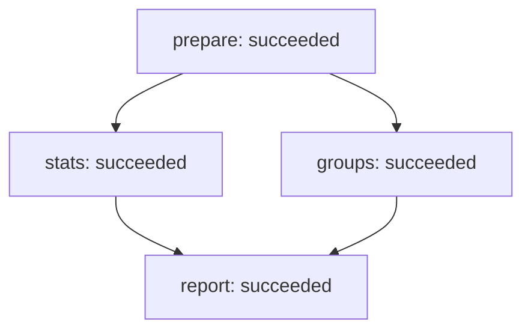

Graph `parallel-join` · version 1 · revision 14

| Node | Owner | State | Dependencies | Evidence (kind/verdict) | Risk / next step |
|---|---|---|---|---|---|
| prepare | single-agent-fixture | succeeded | — | [prepare-check.json](prepare-check.json) (execution/pass, v1) | see node loop and dependency state |
| stats | single-agent-fixture | succeeded | prepare | [stats-check.json](stats-check.json) (execution/pass, v1) | see node loop and dependency state |
| groups | single-agent-fixture | succeeded | prepare | [groups-check.json](groups-check.json) (execution/pass, v1) | see node loop and dependency state |
| report | single-agent-fixture | succeeded | stats, groups | [report-check.json](report-check.json) (execution/pass, v1) | see node loop and dependency state |

Snapshot validation does not prove output correctness, permissions, transition history or deadline enforcement.
