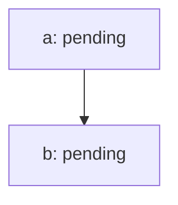

Graph `replan` · version 2 · revision 7

| Node | Owner | State | Dependencies | Evidence (kind/verdict) | Risk / next step |
|---|---|---|---|---|---|
| a | single-agent-fixture | pending | — | [a-check.json](a-check.json) (execution/pass, v1) | see node loop and dependency state |
| b | single-agent-fixture | pending | a | none | see node loop and dependency state |

Snapshot validation does not prove output correctness, permissions, transition history or deadline enforcement.
