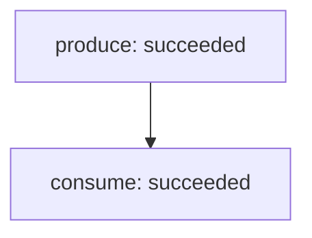

Graph `retry-recover` · version 1 · revision 14

| Node | Owner | State | Dependencies | Evidence (kind/verdict) | Risk / next step |
|---|---|---|---|---|---|
| produce | single-agent-fixture | succeeded | — | [failed-check.txt](failed-check.txt) (execution/fail, v1); [produce-check.json](produce-check.json) (execution/pass, v1) | Numeric parser rejected English text; changed repair: write decimal digits |
| consume | single-agent-fixture | succeeded | produce | [consume-check.json](consume-check.json) (execution/pass, v1) | see node loop and dependency state |

Snapshot validation does not prove output correctness, permissions, transition history or deadline enforcement.
