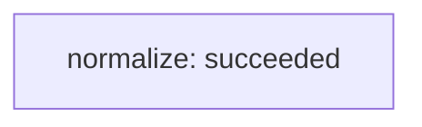

Graph `simple` · version 1 · revision 5

| Node | Owner | State | Dependencies | Evidence (kind/verdict) | Risk / next step |
|---|---|---|---|---|---|
| normalize | single-agent-fixture | succeeded | — | [normalize-check.json](normalize-check.json) (execution/pass, v1) | see node loop and dependency state |

Snapshot validation does not prove output correctness, permissions, transition history or deadline enforcement.
